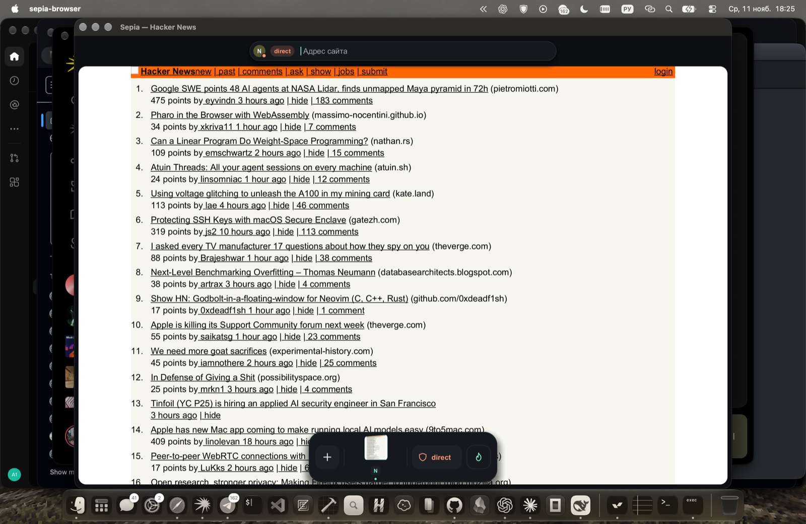
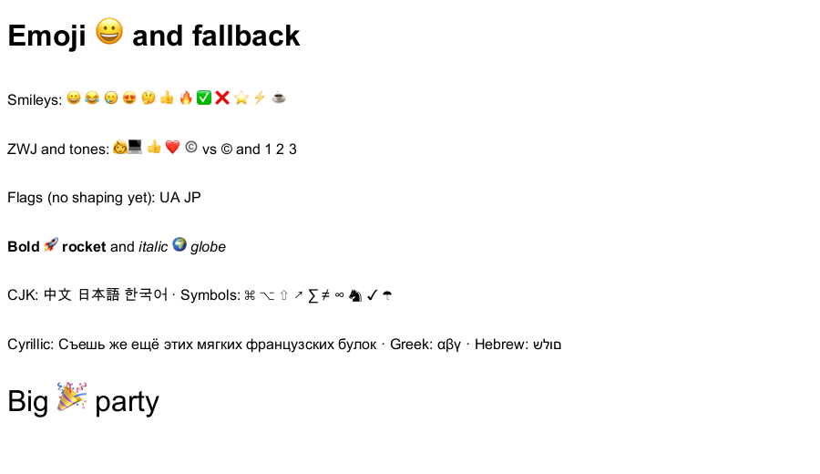
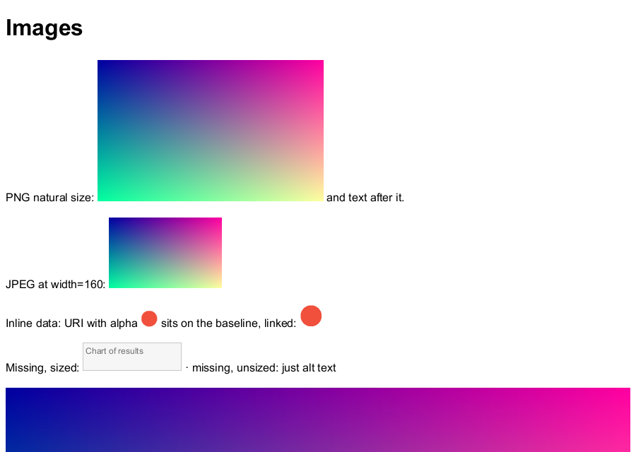
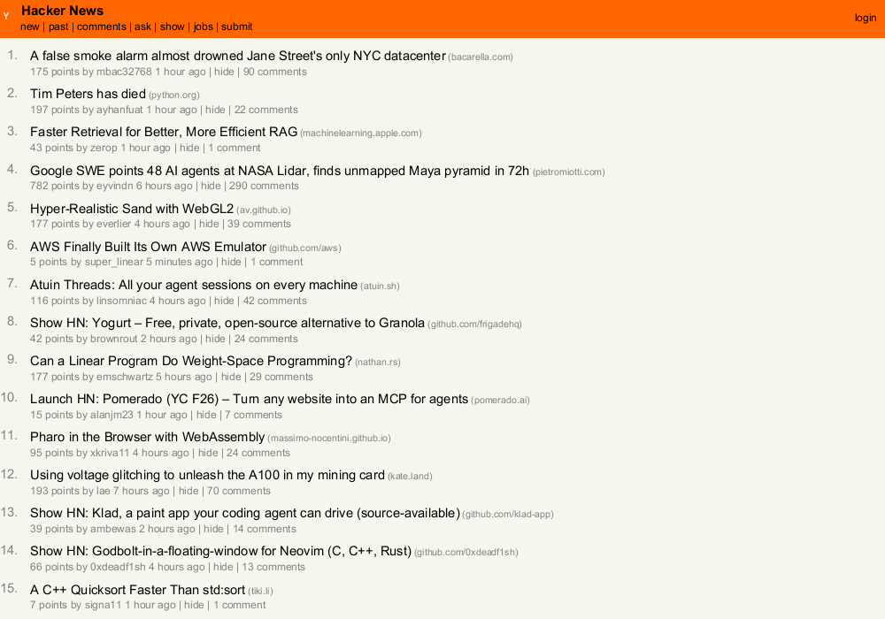
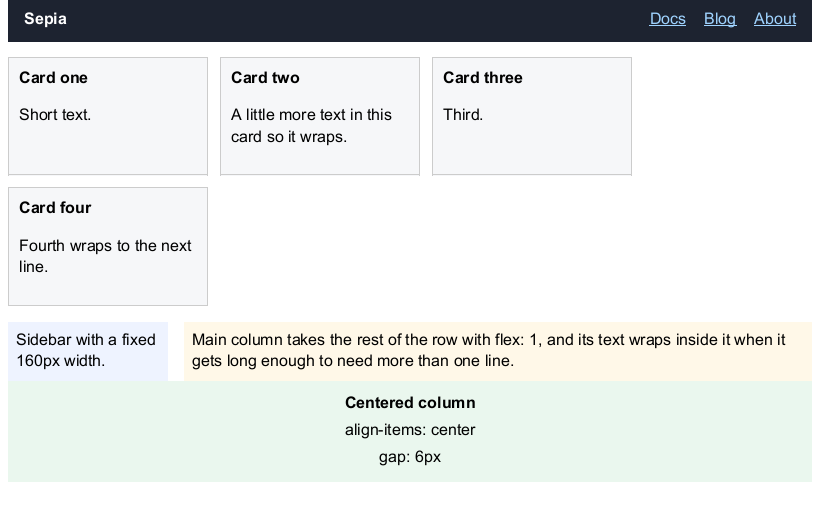
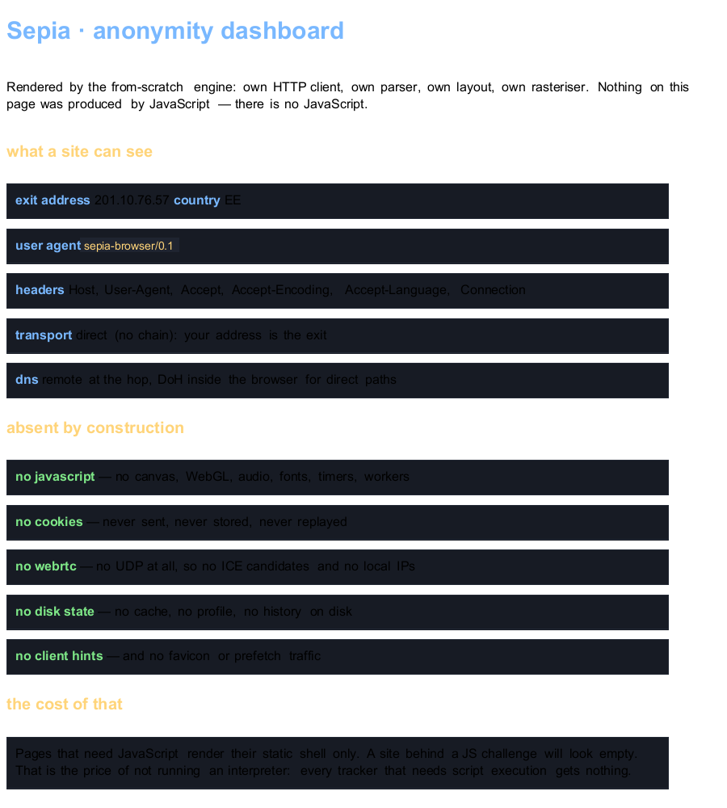
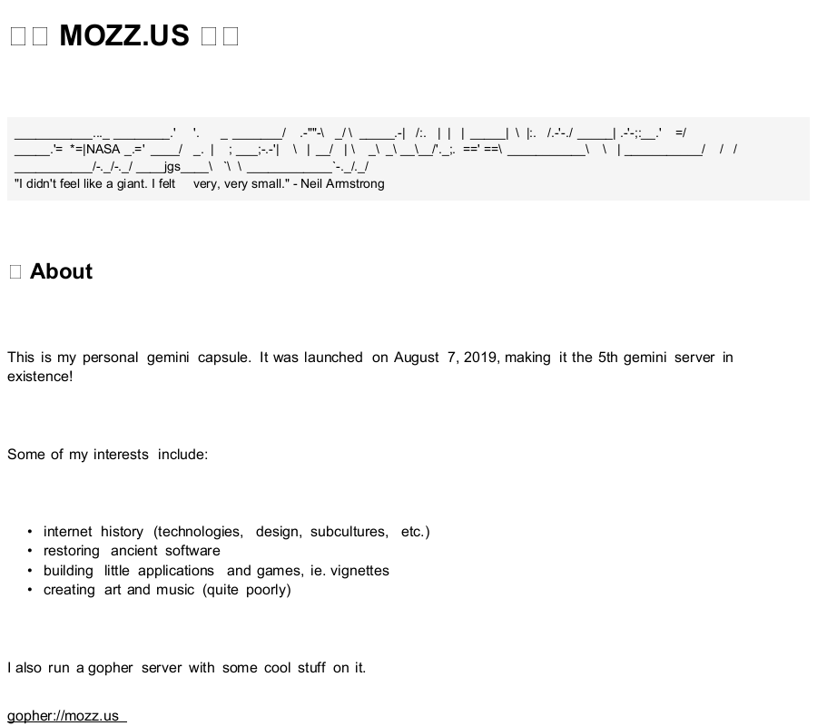

# Sepia

**Anonymity system with its own browser engine.** A proxy chain that fails closed,
DNS that never leaks, and a browser written from scratch: URL parser, HTTP client,
HTML, CSS, layout, rasteriser, window. No Chromium under it, no JavaScript inside it.

```
   app ──► pf / nftables / WinINET ──► SOCKS5 · HTTP ──► hop1 → hop2 → … → exit
                                        │
                                        └── DoH resolver (names never hit the ISP)
```

Sepia (сепия) is the warm brown of old paper — a browser that shows you the page,
not a hundred trackers underneath it.

---

## What is in here

| Часть | Язык | Что делает |
|---|---|---|
| `sepia` CLI | Python 3.9+, stdlib | цепочка, killswitch (pf / nftables / Windows Firewall), системный прокси, DoH, верификация утечек |
| `sepia-core` | Rust (tokio, rustls) | data plane: SOCKS5/HTTP через цепочку, DoH-резолвер, кэш, блок-лист, `/status`; статический бинарник ~3 МБ |
| `sepia-browser` | Rust, с нуля | браузер: свой HTTP/1.1+TLS, HTML-парсер, CSS-каскад, вёрстка, растеризатор, шрифты с фолбэком, картинки, окно, Tor/I2P/Gemini/Gopher |
| `sepiaprobe` | C++17, без зависимостей | собирает ClientHello, считает JA3, отправляет его через цепочку и показывает, что ответил сервер |

## Быстрый старт

```bash
git clone https://github.com/t7/Sepia && cd Sepia

# CLI (нужен python3.9+)
./sepia.sh init
./sepia.sh config validate

# собрать нативные части (нужен rust и c++)
bash scripts/build.sh

# браузер с нуля
cargo build --release --manifest-path browser/Cargo.toml
./sepia.sh browser --native https://news.ycombinator.com
```

Поднимаем всю систему:

```bash
# 1. прописать хопы в ~/.sepia/config.json
# 2. проверить цепочку до локаута
./sepia.sh chain

# 3. поднять цепочку + killswitch (+ системный прокси)
sudo ./sepia.sh up --system-proxy

# 4. доказать, что утечек нет
./sepia.sh verify
./sepia.sh selftest

# 5. анонимный браузер на этой цепочке
./sepia.sh browser --native https://example.com

# 6. вернуть сеть
sudo ./sepia.sh down      # или: sudo ./sepia.sh panic
```

## Браузер с нуля



Свой движок, не webview:

* **сеть** — HTTP/1.1, chunked, редиректы, TLS (`rustls`), SOCKS5- и HTTP-хопы, DoH для прямых соединений;
* **HTML** — токенизатор (теги, атрибуты, комментарии, raw-text `script/style`, сущности), нестрогое дерево с неявными закрытиями;
* **CSS** — правила, селекторы (тег/класс/id/потомок), специфичность, каскад, наследование, `margin/padding/border`, `flex` (row/column, justify, align, gap, grow, wrap), табличная модель с колонками;
* **вёрстка** — блочный поток, инлайн-строки с переносом по метрикам глифов, списки, выравнивание;
* **текст** — фолбэк шрифтов по codepoint, цветные эмодзи, CJK/кириллица/греческий/иврит;
* **картинки** — PNG, JPEG, GIF (первый кадр), `data:`; декодирование в памяти, без сети и диска;
* **окно** — адресная строка, вкладки, история, скролл, клики по ссылкам, экран ошибок, индикатор транспорта.






## Анонимность как свойство конструкции

Браузер просто не имеет поверхности для фингерпринтинга:

* **нет JavaScript** — нет canvas, WebGL, audio, шрифтовых проб, таймеров, `navigator`, WebRTC;
* **нет куки** — не отправляются, не хранятся, не воспроизводятся;
* **нет диска** — ни кэша, ни профиля, ни истории; единственная запись — `--dump` PNG;
* **минимальные заголовки** — ровно шесть: `Host`, `User-Agent`, `Accept`, `Accept-Encoding`, `Accept-Language`, `Connection`. Без `Referer`, `Cookie`, `Sec-CH-*`, `DNT`;
* **DNS не утекает** — DoH внутри браузера, для цепочки имя резолвит первый хоп.

```console
$ ./sepia.sh browser --native --audit

absent by construction
  javascript       no JS engine at all: no canvas, no WebGL, no fonts API, no timers
  cookies          not implemented: nothing is sent, stored or replayed
  webrtc           not implemented: no UDP, no ICE, no local address exposure
  cache / profile  no disk state: nothing written unless you --dump a PNG
network path
  dns              DoH via https://cloudflare-dns.com/dns-query
  transport        chain 127.0.0.1:9050
live check
  ip=… loc=…
```



## Tor, I2P, Gemini, Gopher

```bash
./sepia.sh browser --native --via tor https://check.torproject.org/
./sepia.sh browser --native --via tor http://duckduckgogg42xjoc72x3sjasowoarfbgcmvfimaftt6twagswzczad.onion/
./sepia.sh browser --native --via i2p http://stats.i2p/
./sepia.sh browser --native gemini://mozz.us/
./sepia.sh browser --native gopher://floodgap.com/1/
```

* `.onion` идёт через Tor SOCKS (remote DNS), `.i2p` — через HTTP-прокси роутера абсолютным URI;
* без нужного транспорта браузер не «ходит напрямую», а говорит, чего не хватает;
* Gemini и Gopher — свои клиенты: gemtext → HTML (заголовки, списки, `=>`-ссылки, блоки), меню Gopher с кликабельными селекторами.




## CLI

```bash
./sepia.sh init | config show|validate|path
./sepia.sh chain                 # проверить каждый хоп + exit IP
./sepia.sh dns example.com       # резолв через DoH по цепочке
sudo ./sepia.sh up [--engine rust] [--system-proxy] [--no-transparent] [--dry-run]
sudo ./sepia.sh down
sudo ./sepia.sh panic [--wipe-logs] [--all]
./sepia.sh status                # счётчики, маршруты, DNS-кэш
./sepia.sh verify [--json]       # exit IP, DNS-позиция, заголовки, JA3, enforcement
./sepia.sh audit                 # JA3, hostname, IPv6, резолверы, сокеты
./sepia.sh selftest              # killswitch обязан держать
./sepia.sh probe [--sni host] [--send] [--through local]   # JA3 через C++
./sepia.sh browser [--native] [--selftest] [--via tor|i2p]
```

`up` проверяет цепочку **до** применения правил и откатывается сам, если после
локаута путь сломался (петля редиректа, локальный хоп без `bypass_uids`).

## Платформы

| | killswitch | прозрачный перехват |
|---|---|---|
| **Linux** | `nftables`, `policy drop` + `SO_MARK` для egress | полный, включая HTTPS (`SO_ORIGINAL_DST`) |
| **macOS** | `pf`, снимок правил и восстановление | только HTTP (Darwin не отдаёт original dst); остальное — системный прокси + SOCKS, fail-closed |
| **Windows** | Windows Firewall «блок дополнения до `0.0.0.0/0` кроме хопов» | нет (без TUN/WinDivert); WinINET/WinHTTP + DNS на `127.0.0.1` |

## Чего нет — честно

* JavaScript: страницы на JS рендерят только статическую оболочку.
* `float`-обтекание, полный `grid`, анимации, формы-сабмит, `:hover`/`:active`, `position: absolute/fixed`.
* Шейпинг сложных шрифтов (ligatures, bidi): кириллица/греческий/иврит есть, арабский и деванагари — нет.
* Против глобального наблюдателя нужна луковичная маршрутизация, а не цепочка хопов.
* Первый хоп всегда знает ваш адрес. TLS-отпечаток браузера — отпечаток rustls, а не Chrome.

## Тесты

```bash
python3 -m unittest discover -s tests       # 36  (CLI, DNS, протоколы, браузер-персоны)
cargo test --release --manifest-path core/Cargo.toml    # 19  (data plane)
cargo test --release --manifest-path browser/Cargo.toml # 83  (движок браузера)
bash tests/core_e2e.sh                      # 14  (цепочка, DoH, блок-лист, control)

# Linux-контейнер с NET_ADMIN: nftables, killswitch, прозрачный HTTPS
docker build -t sepia-test -f tests/Dockerfile .
docker run --rm --cap-add=NET_ADMIN -v "$PWD":/src -w /src sepia-test bash /src/tests/linux_e2e.sh   # 16
```

## Структура

```
sepia/
├── sepia.sh                     # запуск CLI без установки
├── pyproject.toml               # pip install .  → команда sepia
├── sepia/                       # Python CLI
│   ├── cli.py  config.py  service.py
│   ├── proxy.py  socks5.py  chain.py  dnsd.py  dnsmsg.py  httpc.py
│   ├── verify.py  fingerprint.py
│   ├── browser.py  cdp.py  ws.py  browser_ext/sepia-shim.js
│   └── platforms/{darwin,linux,windows}.py
├── core/                        # sepia-core (Rust)
├── browser/                     # sepia-browser (Rust)
│   └── src/{main,url,net,resolver,html,dom,css,style,layout,paint,images,fonts,gui,page,protocols}.rs
├── native/sepiaprobe.cpp        # C++17 JA3
├── scripts/build.sh             # сборка + все тесты
├── docs/                        # скриншоты, фикстуры, контракт для движка
└── tests/
```

## Лицензия

MIT — см. [LICENSE](LICENSE). Проект раньше назывался `veil`; при первом запуске
`~/.veil` копируется в `~/.sepia`, старые `VEIL_*` переменные ещё читаются.
