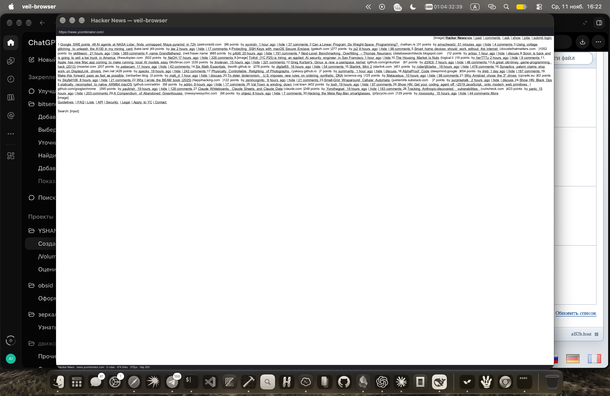
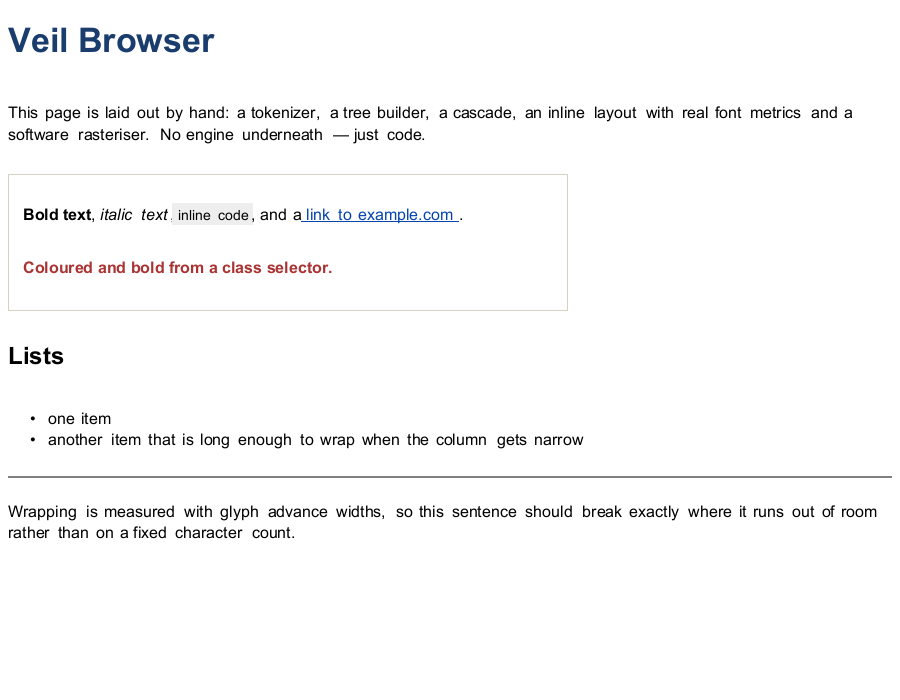
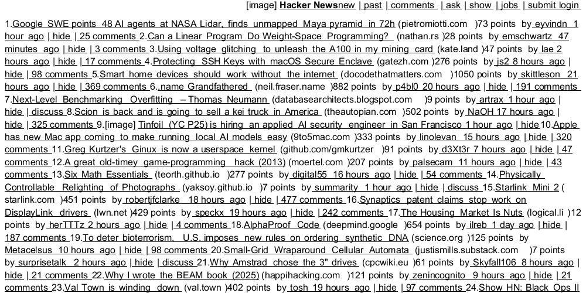
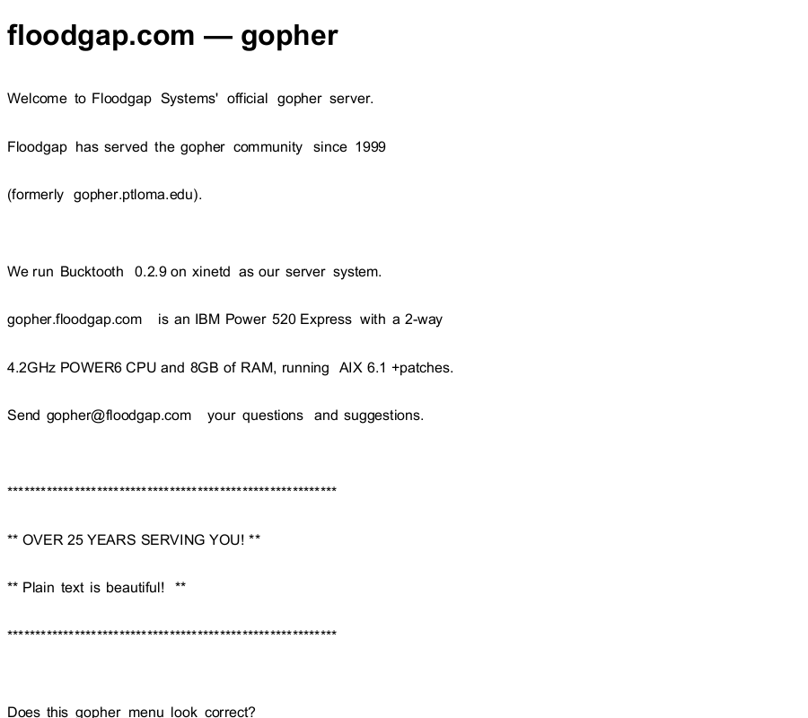

# Sepia

Тотальная анонимизация трафика: цепочка прокси, DNS без утечек, fail-closed killswitch и доказательство того, что всё это действительно работает.

Не «включил VPN и надеюсь». Программа считает анонимность системой слоёв, где каждый слой закрывает утечку предыдущего, а `sepia verify` проверяет результат снаружи.

```
приложение
   │
   ├─ (1) прозрачный перехват: pf rdr / nftables REDIRECT  ─┐
   ├─ (2) системный прокси (networksetup / gsettings / WinINET)
   ├─ (3) SOCKS5 :10800  +  HTTP :18080                    ─┤
   │                                                        ▼
   │                                            цепочка хопов (socks5/http)
   │                                            hop1 → hop2 → … → exit
   ├─ (4) DNS: только DoH через цепочку, 53-й порт перехвачен
   └─ (5) killswitch: всё, что не в цепочку, умирает
```

---

## Что реально даёт

| Слой | Что закрывает |
|---|---|
| Цепочка прокси | сеть видит только первый хоп; сайт видит только последний |
| Прозрачный перехват | приложения, которые «забыли» про прокси, всё равно идут в цепочку (по умолчанию — Linux, включая HTTPS) |
| DoH через цепочку | ни один DNS-запрос не выходит в открытом виде; провайдер не видит имён |
| Killswitch | при падении цепочки трафик не «протекает» напрямую, а умирает |
| IPv6-блок | dual-stack не даёт обойти IPv4-правила |
| `verify` | проверка exit IP, DNS-резолвера, заголовков, JA3, факта блокировки |

---

## Три части

| Компонент | Язык | Что делает |
|---|---|---|
| `sepia` (CLI) | Python 3.9+, stdlib | оркестрация: правила, killswitch, системный прокси, проверки |
| `sepia-core` | Rust (tokio + rustls) | data plane: SOCKS5/HTTP через цепочку, DoH-резолвер, счётчики; статический бинарник 3 МБ |
| `sepiaprobe` | C++17, без зависимостей | собирает ClientHello, считает JA3, показывает отпечаток TLS и проверяет путь через цепочку |
| `sepia browser` | Python + CDP | анонимизированный Chromium: персона, оверрайды, шим, WebRTC-гашение |
| `sepia-browser` | Rust, с нуля | **свой браузер**: HTTP(S)-клиент, HTML-парсер, CSS-каскад, вёрстка, растеризатор, окно |

---

## Установка

Нужен Python 3.9+ и ничего больше — зависимостей нет.

```bash
# из исходников, без установки
cd sepia
./sepia.sh init
./sepia.sh config validate

# или в систему
python3 -m pip install --user .
sepia --version
```

Платформенные требования:

* **macOS** — `pfctl`, `networksetup` (есть в системе).
* **Linux** — `nftables` (`apt install nftables`), для системного прокси опционально `gsettings` + `systemd-resolved`.
* **Windows** — PowerShell, `netsh`, `reg` (есть в системе). Анонимизация работает в режиме system-proxy + firewall; прозрачного перехвата нет (см. ограничения).

---

## Быстрый старт

1. Завести конфиг:

```bash
./sepia.sh init            # ~/.sepia/config.json
```

2. Прописать хопы (первый — тот, что видит ваша сеть; последний — «выход в мир»):

```json
"chain": {
  "hops": [
    {"type": "socks5", "addr": "127.0.0.1:9050", "label": "tor-local"},
    {"type": "socks5", "addr": "203.0.113.10:1080", "username": "u", "password": "p"},
    {"type": "http",   "addr": "proxy.example.net:3128"}
  ],
  "on_hop_failure": "fail"
}
```

3. Проверить цепочку до блокировки сети:

```bash
./sepia.sh chain          # каждый хоп + exit IP
./sepia.sh dns example.com  # резолв через DoH по цепочке
```

4. Поднять всё:

```bash
sudo ./sepia.sh up                 # прокси + killswitch + прозрачный перехват
sudo ./sepia.sh up --system-proxy  # плюс системные настройки прокси и DNS
./sepia.sh status                  # счётчики, маршруты, DNS-кэш
```

5. Доказать, что утечек нет:

```bash
./sepia.sh verify     # exit IP, DNS, заголовки, JA3, enforcement
./sepia.sh selftest   # прямой запрос ОБЯЗАН умереть, запрос через прокси — работать
```

6. Снять всё:

```bash
sudo ./sepia.sh down      # вернуть сеть и настройки
sudo ./sepia.sh panic     # если что-то пошло не так: жёсткий сброс
```

---

## Анонимизированный браузер

```bash
sudo ./sepia.sh up --system-proxy      # цепочка + DNS + killswitch
./sepia.sh browser https://example.com  # браузер на этой цепочке
./sepia.sh browser --selftest           # headless-проверка: что реально видит сайт
```

Что происходит при запуске:

1. **Персона** строится из exit-гео: страна выхода → часовой пояс, языки, экран, ядра, объём памяти, GPU-строки. Одна сессия — один консистентный «компьютер», новая сессия — другой.
2. **Нативные оверрайды через CDP** (не JS-подделка): `Emulation.setTimezoneOverride`, `setLocaleOverride`, `setHardwareConcurrencyOverride`, `setDeviceMetricsOverride` (экран + DPR). Плюс `TZ=` в окружении как второй слой.
3. **Шим на `document_start`** добивает то, что браузеру не расскажешь: canvas-шум (детерминированный по seed), audio-шум, WebGL vendor/renderer, `navigator.webdriver=false`, лимиты железа.
4. **WebRTC**: `disable_non_proxied_udp` + переписывание SDP (вырезаются `host`-кандидаты с локальными IP). Есть `--strict-webrtc` — выключить совсем.
5. **Только прокси**: `--proxy-server=socks5://…`, `--host-resolver-rules=MAP * ~NOTFOUND` (при этом loopback разрешён), `--disable-quic`, без синхронизации/телеметрии, временный профиль, который затирается на выходе.
6. **UA не подменяется** намеренно: HTTP-заголовки, Client Hints, TLS и HTTP/2 берутся из одного и того же Chrome — врать в JS при настоящем UA значит ловить несоответствие. Реальность важнее картинки.

`--selftest` — это честная проверка, а не красивое слово: headless-запуск через тот же путь, страница снимает `navigator.*`, `screen`, `Intl`, `WebGL`, ICE-кандидаты и exit IP, а `sepia` сравнивает всё с персоной:

```
[OK  ] screen.width: 1600        [OK  ] timezone: 'Europe/Tallinn'
[OK  ] hardwareConcurrency: 8    [OK  ] webrtc_no_local_ip: []
[OK  ] webglRenderer: 'ANGLE (Apple, ANGLE Metal Renderer: Apple M1...)'
[OK  ] exit_ip_present: True
```

Полезные флаги: `--seed` (воспроизвести персону), `--country`, `--timezone`, `--lang`, `--persist` (постоянный профиль), `--no-proxy` (для сравнения), `--strict-webrtc`.

Почему CDP, а не расширение: Chrome в стабильных сборках больше не грузит `--load-extension`, а расширение всё равно инжектит слабее. Управление идёт по `--remote-debugging-port=0` (порт выдаёт ядро, endpoint с UUID) и своему минимальному WebSocket-клиенту — без Playwright и прочих зависимостей.

---

## Браузер с нуля (`--native`)

Это не обёртка и не webview: движок написан целиком здесь.

```bash
cargo build --release --manifest-path browser/Cargo.toml

./sepia.sh browser --native https://example.com            # окно
./sepia.sh browser --native https://example.com --dump page.png --width 1000 --height 800
./sepia.sh browser --native https://example.com --text     # только текст
```

Что реализовано:

| Слой | Где | Что делает |
|---|---|---|
| URL | `browser/src/url.rs` | разбор http/https, порт по умолчанию, относительные ссылки, `..`, `//host` |
| Сеть | `net.rs` | свой HTTP/1.1: `Content-Length`, chunked, редиректы, TLS (rustls), SOCKS5-цепочка |
| HTML | `html.rs` | токенизатор: теги, атрибуты в кавычках и без, комментарии, `script/style` как raw text, сущности (`&amp;`, `&#x41;`) |
| Дерево | `dom.rs` | нестрогий парсер с неявными закрытиями (`p`, `li`, `td`), поиск и текст |
| CSS | `css.rs` | правила, `@media` выбрасывается, селекторы (тег/`.class`/`#id`/потомок), специфичность, цвета `#rgb/#rrggbb/rgb()/имена` |
| Стили | `style.rs` | UA-стили по тегам, наследование, каскад, inline `style`, `margin/padding/border`, `em/%/px`, `line-height` |
| Вёрстка | `layout.rs` | блочный поток, инлайн-строки с переносом по метрикам глифов (fontdue), списки, маркеры, фоны и рамки, выравнивание |
| Растр | `paint.rs` | заливка/рамки/clip, глифы с антиалиасингом, подчёркивание, PNG |
| Окно | `gui.rs` | адресная строка, скролл (колесо/клавиши), клики по ссылкам, история вперёд/назад, статус-бар |

Скриншоты (все сделаны этим движком, без внешних браузеров):







Проверено на живых страницах: `example.com`, `news.ycombinator.com` (478 ссылок, 729 текстовых узлов), `en.wikipedia.org/wiki/Web_browser` (14 717px высоты, 101 правило CSS, 5 044 текстовых узла).

```
$ ./sepia.sh browser --native https://news.ycombinator.com --dump hn.png
url         https://news.ycombinator.com/
status      200
title       Hacker News
styles      0 rules
page height 761px
links       478
```

### Анонимность как свойство конструкции

```
$ ./sepia.sh browser --native --audit
absent by construction
  javascript       no JS engine at all: no canvas, no WebGL, no fonts API, no timers
  cookies          not implemented: nothing is sent, stored or replayed
  webrtc           not implemented: no UDP, no ICE, no local address exposure
  cache / profile  no disk state: nothing written unless you --dump a PNG
network path
  dns              DoH via https://cloudflare-dns.com/dns-query (bootstraps: 1.1.1.1, 1.0.0.1)
  transport        chain 127.0.0.1:51800
live check
  ip=201.10.76.57  loc=EE
```

Два важных следствия:

* **JS-поверхности нет вообще** — значит нет canvas/WebGL/audio/шрифтовых проб, нет `navigator`, нет таймеров, нет WebRTC с локальными IP. Трекеры, которым нужен скрипт, получают пустоту.
* **DNS не утекает**: для прямых соединений имя разрешается через DoH внутри браузера (`resolver.rs`), для цепочки — на первом хопе (SOCKS5 с именем хоста). Системный резолвер не участвует, если не передать `--no-doh`.


### Другие сети: Tor, I2P, Gemini, Gopher

Браузер умеет не только clearnet. Транспорт — это цепочка хопов, поэтому оверлеи подключаются одной строкой:

```bash
./sepia.sh browser --native --via tor https://check.torproject.org/   # SOCKS5 127.0.0.1:9050
./sepia.sh browser --native --via tor http://duckduckgogg42xjoc72x3sjasowoarfbgcmvfimaftt6twagswzczad.onion/
./sepia.sh browser --native --via i2p http://stats.i2p/                # HTTP-прокси 127.0.0.1:4444
./sepia.sh browser --native gemini://mozz.us/                          # Gemini: TLS + одна строка
./sepia.sh browser --native gopher://floodgap.com/1/                   # Gopher: меню и файлы
```

* **Tor** — `.onion` проходит через SOCKS5, имя резолвит сам Tor (remote DNS). Если цепочки нет, браузер не пытается «просто сходить» и честно говорит: `onion names live on Tor: start tor and use --via tor`.
* **I2P** — `.i2p` идёт через HTTP-прокси роутера абсолютным URI (`GET http://x.i2p/...`), как он и требует. Хоп типа `http://` теперь полноценный участник цепочки, с `CONNECT` для https/gemini/gopher.
* **Gemini** — свой клиент: TLS, запрос одной строкой, ответ `STATUS META`, gemtext → HTML (заголовки, списки, `=>`-ссылки, ```` ``` ````-блоки). Capsules почти всегда на самоподписанных сертификатах, поэтому есть `--insecure` (TOFU по духу протокола).
* **Gopher** — свой клиент: селектор в одну строку, разбор меню (`1`/`0`/`i`/`h`…), кликабельные ссылки `gopher://host:port/Tselector`, текст-файлы открываются как `<pre>`.




Проверено вживую: `gemini://mozz.us/` (status 20, 151 ссылка) и `gopher://floodgap.com/1/` (166 ссылок, страница 4627px).

**Чего нет** (без вранья): JavaScript-движка, `float/flex/grid`, табличной модели (ячейки просто инлайн-боксы), декодирования картинок (плейсхолдеры с `alt`), форм-сабмита, шрифтовых фолбэков, и всего остального, что делает Chromium десятилетиями. Это настоящий движок, но маленький — как Lynx/Dillo, а не как Chrome.

---

## Два движка трафика

```bash
sudo ./sepia.sh up                   # python (по умолчанию)
sudo ./sepia.sh up --engine rust     # rust core: тот же конфиг, тот же control API
```

Rust-ядро умеет: SOCKS5 и HTTP (CONNECT + absolute-URI), цепочку хопов с auth, `on_hop_failure`, маршруты `chain/direct/block`, DoH-резолвер с кэшем и блок-листом, `/status` со счётчиками, SO_MARK на Linux.

Чего в Rust-ядре пока нет: прозрачного перехвата (`--transparent` работает только с python-движком — CLI откажется запускать rust с прозрачностью, чтобы не оставить порт без слушателя) и системного прокси (это делает Python-обвязка в любом случае).

---

## Отпечаток TLS: `sepiaprobe`

```bash
./sepia.sh probe --sni example.com                      # JA3 того, что мы отправляем
./sepia.sh probe --sni example.com --send --through local
./sepia.sh probe --mode firefox --repeat 5 --json
```

C++ собирает ClientHello вручную (профили chrome/firefox: ciphers, extensions, groups, ALPN), считает MD5 по JA3-строке сам, показывает первые байты и — с `--send` — реально отправляет hello через цепочку, сообщая, что ответил сервер. Заодно видно полезное свойство: рандомизация байтов не меняет JA3, отпечаток — это структура.

---

## Команды

| Команда | Смысл |
|---|---|
| `init` | создать `~/.sepia/config.json` (0600) |
| `config show\|validate\|path` | конфиг и возможности платформы |
| `chain` | проверка каждого хопа и exit IP |
| `dns <имя>` | резолв через DoH по цепочке |
| `up [--system-proxy] [--no-firewall] [--no-transparent] [--dry-run] [--force]` | запуск демона + правила |
| `down` | восстановить сеть |
| `panic [--wipe-logs]` | аварийный сброс всего, что трогал sepia |
| `status` | живые счётчики, топ направлений, DNS-статистика |
| `verify [--json]` | батарея проверок на утечки |
| `audit [--json]` | JA3, hostname, IPv6, системный резолвер, сокеты |
| `selftest` | принудительная проверка killswitch |
| `browser [url…]` | анонимизированный Chromium (`--selftest`, `--seed`, `--strict-webrtc`) |
| `probe` | JA3/ClientHello через `sepiaprobe` (C++) |

Флаги `up`:

* `--system-proxy` — прописать прокси и DNS в ОС (macOS `networksetup`, GNOME `gsettings`, Windows WinINET/WinHTTP).
* `--no-transparent` — не перехватывать прозрачно, только порты 10800/18080.
* `--dry-run` — показать правила, ничего не устанавливать.
* `--force` — блокировать сеть даже если цепочка не отвечает (по умолчанию `up` откажется, чтобы не оставить вас без связи).
* `--engine python|rust` — какой data plane поднимать.

---

## Платформенные детали

### macOS — `pf`

`up` собирает один ruleset и грузит его через `pfctl -f`, включённый pf остаётся включённым:

* `rdr` портов 80/443 на локальный `:18081` (прозрачный HTTP по `Host`), DNS udp/tcp 53 → `:15353`;
* `pass` только на loopback и на IP хопов (таблица `<sepia_hops>`);
* `block drop out quick inet6 all` — IPv6 не убежит;
* `block drop out quick all` — всё остальное умирает.

Перед установкой сохраняется снимок `pfctl -s nat` / `pfctl -s rules`, `down` восстанавливает его байт в байт.

**Ограничение:** pf-редирект на Darwin не отдаёт исходный адрес назначения (`SO_ORIGINAL_DST` отсутствует). Поэтому `firewall.transparent: "auto"` на macOS выключен: HTTPS и всё остальное идут через системный прокси или SOCKS-порт 10800, а то, что игнорирует и их, блокируется killswitch'ем — fail-closed, а не fail-open.

Если всё же включить `transparent: true` на macOS вручную, перехватывается только plain HTTP, и появляется петля: собственный egress sepia'а на 80/443 тоже попадает под `rdr`. Держите такой режим только при цепочке из удалённых хопов и без правил `direct`.

### Linux — `nftables`

```nft
chain out_nat    { type nat hook output priority -100; ... redirect to :18081 }
chain out_filter { type filter hook output priority filter; policy drop; ... }
```

* на `output` стоит REDIRECT тех же портов, а исходный адрес восстанавливается через `SO_ORIGINAL_DST` → **прозрачно работает и HTTPS** (TLS идёт насквозь, без MITM);
* `policy drop` + разрешены только loopback, IP/порты хопов, DHCP;
* сокеты, которые sepia открывает наружу, помечаются `SO_MARK 1`, а в правилах стоит `meta mark 1 return/accept` — иначе собственный egress прокси попал бы под собственный REDIRECT и зациклился;
* локальный хоп, который sepia не запускал (например `tor` под своим UID), разрешается через `firewall.bypass_uids: [uid]`;
* DNS 53/udp и 53/tcp редиректятся на локальный резолвер;
* `nft list table inet sepia` показывает счётчики сработавших редиректов.

### Windows — Windows Firewall + WinINET

Честно про архитектуру: «блокировать всё, кроме X» Windows Firewall не умеет (block-правила побеждают allow-правила). Поэтому killswitch строится от обратного — блокируются все диапазоны IPv4, **кроме** адресов хопов и loopback (вычисляется дополнение до `0.0.0.0/0`), плюс блок `::/0`.

* `New-NetFirewallRule -Direction Outbound -Action Block -RemoteAddress <дополнение>`;
* WinINET/WinHTTP переводятся на `127.0.0.1:18080`;
* DNS интерфейса ставится на `127.0.0.1` (резолвер сам уходит в DoH через цепочку);
* прозрачного перехвата нет — приложения без прокси просто не пройдут.

`down` удаляет правила `sepia-*`, возвращает WinINET и DNS на DHCP.

---

## Конфиг: что доступно

```json
{
  "listen": {
    "socks": "127.0.0.1:10800",
    "http": "127.0.0.1:18080",
    "redirect": "127.0.0.1:18081",
    "dns": "127.0.0.1:15353",
    "control": "127.0.0.1:19099"
  },
  "chain": {"hops": [], "connect_timeout": 12, "on_hop_failure": "fail"},
  "dns": {
    "enabled": true,
    "servers": [
      {"url": "https://cloudflare-dns.com/dns-query",
       "bootstraps": ["1.1.1.1", "1.0.0.1"]}
    ],
    "cache_ttl_max": 3600,
    "block": ["*.doubleclick.net", "tracker.example"],
    "block_response": "0.0.0.0"
  },
  "rules": [
    {"domain": "*.local", "action": "direct"},
    {"domain": "telemetry.example", "action": "block"}
  ],
  "firewall": {
    "enabled": true,
    "killswitch": true,
    "transparent": true,
    "iface": "auto",
    "redirect_ports": [80, 443],
    "block_ipv6": true,
    "allow_lan": false,
    "allow_ports": [22]
  },
  "system_proxy": {"enabled": false}
}
```

* `hop.type` — `socks5` или `http` (CONNECT). `username`/`password` уходят в лог только в виде `***`.
* `on_hop_failure: "skip"` — выпавший хоп выкидывается из цепочки вместо обрыва.
* `dns.servers` — только `https://` (DoH). `bootstraps` — обязательные IP-адреса: DoH-эндпоинт никогда не резолвится по имени, иначе получился бы цикл «DNS спрашивает DNS через себя». TLS-проверка всё равно идёт по имени, адрес пинится только на уровне сокета.
* `firewall.transparent` — `"auto"` (по умолчанию), `true` или `false`. `auto` = включено только там, где восстановление исходного адреса надёжно (Linux).
* `firewall.bypass_uids` — UID'ы, чей трафик не перехватывается и разрешён наружу (локальный хоп: tor, ssh -d, свой демон).
* `firewall.allow_ports` — необязательные порты, разрешённые к хостам цепочки (например, `22` для SSH-хопа).
* `rules` — маршрутизация по домену: `chain` (в цепочку), `direct` (мимо), `block`. Домен покрывает поддомены; `*.example.com` — только поддомены.
* `allow_ports` — необязательные порты, разрешённые к хостам цепочки (например, `22` для SSH-хопа).

---

## Верификация: что именно проверяется

`sepia verify` (через цепочку, без доверия системе):

1. **exit IP** с трёх независимых endpoint'ов; расхождение — предупреждение.
2. **DNS-позиция**: какой резолвер видит внешний мир (`edns.ip-api.com`, с редиректами) — там должен быть DoH-провайдер, а не провайдерский кэш.
3. **Заголовки** запроса — что реально утекает выше прокси.
4. **JA3** — отпечаток вашего ClientHello, посчитанный из реальных байтов (через `MemoryBIO`, без сети). Честная цифра того, как пахнет TLS.
5. **IPv6** — пробуем прямой IPv6-коннект; прошёл — дыра.
6. **Enforcement** — проверяется не «оно упало», а «куда оно вышло»: прямой запрос и запрос через прокси обязаны иметь **один exit IP** (иначе это утечка), порт вне редиректа (8.8.8.8:853) обязан быть закрыт, а `dig @8.8.8.8` должен обслуживаться резолвером sepia (счётчик запросов растёт) — иначе это открытый plaintext DNS.

`selftest` — то же самое, но как жёсткий вердикт: любой прямой проход или открытый DNS-резолвер = FAIL.

`audit` — поверхность утечек хоста: hostname, IPv6-адреса, системные резолверы, TCP-stack (`blackhole`, ICMP rate limit), слушающие сокеты.

---

## Чего это не решает

Анонимность — не бинарная величина, и врать про это не буду:

* **TLS-отпечаток приложения** прокси не меняет. JS/браузер, и тем более JA3, остаются вашими. Для этого нужен браузер с рандомизацией отпечатка, а не прокси.
* **Корреляция трафика** (размеры, тайминги, объёмы) — против глобального наблюдателя нужна луковичная маршрутизация с фиксированным темпом, а не цепочка хопов.
* **Прошивка устройства, MAC, hostname** локально утекают; `audit` о них честно сообщает.
* **Windows** без TUN/WinDivert не перехватывает трафик прозрачно: приложение, игнорирующее прокси, просто умирает по firewall'у.
* **Скомпрометированный первый хоп** знает ваш IP. Цепочка защищает от сайтов и от последующих хопов, не от первого.
* **Операционная безопасность** (логины, куки, аккаунты, язык, часовой пояс) аннулирует всё вышеописанное. Инструмент не заменяет гигиену.

---

## Безопасность при сбоях

* `up` проверяет цепочку **до** применения правил и откажется блокировать сеть, если exit недоступен (обойти: `--force`).
* после применения правил `up` ещё раз проверяет цепочку и, если что-то сломалось (петля редиректа, локальный хоп без `bypass_uids`), **сам откатывает** файрвол, системный прокси и демон.
* нет хопов + killswitch → отказ, а не мёртвать: иначе сеть умирает вся.
* Если залочились: `sudo sepia panic` — снимает правила (pf/nft/netsh), возвращает системный прокси и DNS, убивает демон.
* Демон пишет pid, состояние и счётчики; `status` ходит на loopback-control.
* Секреты: конфиг `0600`, пароли хопов в логах редактируются.

---

## Тесты

```bash
scripts/build.sh                             # сборка rust + c++, все тесты
cargo test --release --manifest-path core/Cargo.toml   # 17 тестов rust
bash tests/core_e2e.sh                       # 14 проверок data plane
python3 -m unittest discover -s tests -v     # 36 юнит-тестов python, без root и сети
cargo test --release --manifest-path browser/Cargo.toml  # 40 тестов браузера
docker build -t sepia-test -f tests/Dockerfile .
docker run --rm --cap-add=NET_ADMIN sepia-test bash /src/tests/linux_e2e.sh
```

Второй набор — Linux-end-to-end внутри контейнера с `NET_ADMIN`: nftables грузится; порты вне редиректа (853, 4444) закрыты; прямой и прокси-запросы выходят **одним и тем же** exit IP; plaintext DNS перехватывается резолвером sepia; при этом работают HTTP-прокси, SOCKS5, прозрачный HTTP и прозрачный HTTPS (через `SO_ORIGINAL_DST`), DoH по UDP и TCP; `down` возвращает сеть и удаляет таблицу. 16 проверок.

---

## Структура

```
sepia/
├── sepia.sh                  # запуск из исходников
├── pyproject.toml
├── scripts/build.sh         # собрать rust + c++, прогнать тесты
├── core/                    # sepia-core на Rust (tokio, rustls)
│   ├── Cargo.toml
│   └── src/{main,config,chain,socks5,proxy,dns,rules}.rs
├── browser/                 # sepia-browser: браузер с нуля на Rust
│   ├── Cargo.toml
│   └── src/{main,url,net,html,dom,css,style,layout,paint,gui}.rs
├── native/sepiaprobe.cpp     # C++17: ClientHello, JA3, путь через цепочку
├── docs/                    # скриншоты рендера
├── sepia/
│   ├── cli.py               # команды
│   ├── config.py            # схема, дефолты, валидация
│   ├── service.py           # демон, pid, fork
│   ├── proxy.py             # SOCKS5 + HTTP + прозрачный режим
│   ├── socks5.py            # протокол (клиент и сервер)
│   ├── chain.py             # хопы, маршруты, health
│   ├── dnsmsg.py            # DNS wire-format
│   ├── dnsd.py              # DoH-резолвер и локальный сервер
│   ├── httpc.py             # HTTP-клиент по цепочке
│   ├── verify.py            # батарея проверок
│   ├── fingerprint.py       # JA3, аудит хоста
│   ├── browser.py           # персоны, запуск Chromium, selftest
│   ├── cdp.py               # Chrome DevTools Protocol поверх своего WebSocket
│   ├── ws.py                # RFC 6455 клиент
│   ├── browser_ext/sepia-shim.js   # шим document_start
│   └── platforms/           # darwin (pf), linux (nft), windows (WFP-обход)
└── tests/
    ├── test_sepia.py
    ├── Dockerfile
    └── linux_e2e.sh
```

Python ≥ 3.9 (stdlib only) для CLI. Rust и C++ — только если собираете `sepia-core` и `sepiaprobe` (`scripts/build.sh`).

---

## Переезд с veil

Проект раньше назывался `veil`. Всё переименовано, совместимость сохранена:

* при первом запуске `~/.veil` копируется в `~/.sepia` (старый каталог остаётся, рядом кладётся маркер `MIGRATED_FROM_VEIL`);
* переменные окружения читаются новые (`SEPIA_CORE`, `SEPIA_BROWSER`, `SEPIA_CFT_DIR`, `SEPIA_VERBOSE`, `SEPIA_FONT`), но старые `VEIL_*` ещё понимаются;
* правила файрвола теперь `sepia-*` / `<sepia_hops>` / `table inet sepia`; `sepia down` дополнительно чистит старые `veil-*` правила, если они остались от предыдущей версии.

## Дополнительно: настройки хоста

`sepia audit` показывает, что видно снаружи до всякой анонимизации. Ручные шаги, которые он порекомендует (нужен root, сами решаете):

```bash
# macOS: не отвечать на сканирование, резать ICMP
sudo sysctl -w net.inet.tcp.blackhole=2 net.inet.udp.blackhole=1 net.inet.icmp.icmplim=50
# Linux
sudo sysctl -w net.ipv4.tcp_syncookies=1 net.ipv4.conf.all.rp_filter=1 \
                net.ipv4.icmp_echo_ignore_broadcasts=1
```

Отдельно: hostname уходит в LAN через DHCP/mDNS — `audit` его показывает; JA3 приложения прокси не меняет; для этого нужен браузер с рандомизацией отпечатка.

---

## Лицензия

MIT.
